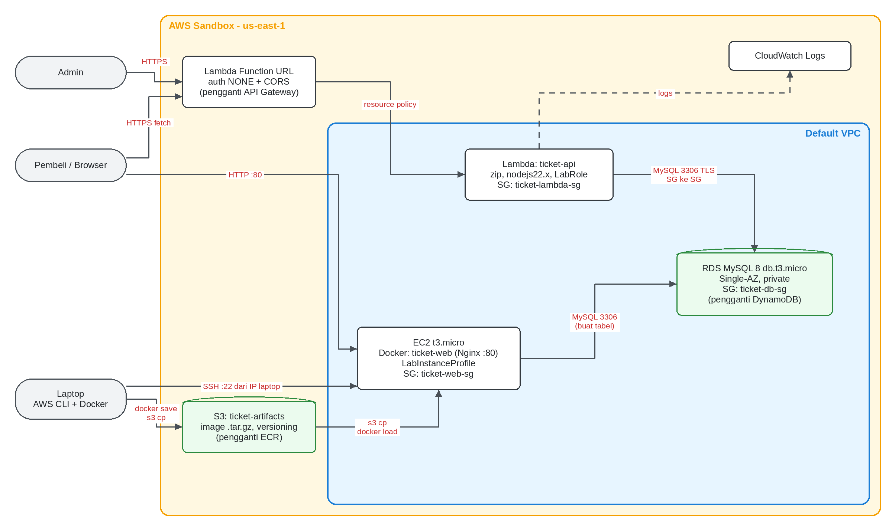

# ticketing-service

Layanan penjualan tiket acara dengan kursi bernomor. Pembeli bisa melihat denah kursi, menahan satu kursi selama checkout, lalu menyelesaikan pembelian. Sistem menjamin satu kursi tidak pernah terjual ke dua orang, walaupun banyak orang menekan tombol di detik yang sama.

Proyek ini menggabungkan Track B (Docker di EC2) dan Track C (Lambda), dan dijalankan di AWS Academy sandbox (`us-east-1`).



Sumber diagram: [`docs/architecture.mmd`](docs/architecture.mmd). Versi yang bisa diedit: [`docs/architecture.excalidraw`](docs/architecture.excalidraw), buka di excalidraw.com lewat File → Open.

## Komponen

| Service | Isi | Jalan di |
|---|---|---|
| `ticket-api` | API kursi: CRUD, hold, confirm (Node.js 22, `mysql2`) | Lambda (zip, di dalam VPC) lewat Function URL |
| `ticket-web` | Halaman denah kursi (Nginx) | Docker di EC2, image disimpan di S3 |
| Database | Tabel `seats` | RDS MySQL 8, privat, Single-AZ |

## Perubahan dari rancangan awal

Rancangan awalnya memakai API Gateway, Lambda dari container image di ECR, dan DynamoDB. Akun sandbox menolak ketiga layanan itu, jadi masing-masing diganti:

| Rancangan awal | Pengganti | Dampak |
|---|---|---|
| API Gateway HTTP API | Lambda Function URL | Tidak ada tabel route, jadi routing dibuat di kode |
| Lambda container image (ECR) | Lambda paket zip | Kode sama, cara deploy berbeda |
| DynamoDB | RDS MySQL | Hold tetap atomik lewat `UPDATE … WHERE`, Lambda harus masuk VPC |
| ECR | S3 (`docker save` / `docker load`) | Image dipindahkan sebagai file `.tar.gz` |
| IAM role khusus | `LabRole`, `LabInstanceProfile` | Sandbox tidak mengizinkan membuat role baru |

Penjelasan lengkap ada di [design brief](docs/design-brief.pdf).

## API

Semua path diawali `/events/{eventId}/seats`.

| Operasi | Method | Path | Sukses | Error |
|---|---|---|---|---|
| Tambah kursi | POST | `/` | 201 | 400, 409 |
| Lihat denah (`?status=`) | GET | `/` | 200 | 400 |
| Lihat satu kursi | GET | `/{seatId}` | 200 | 404 |
| Ubah harga | PUT | `/{seatId}` | 200 | 400, 404, 409 |
| Hapus kursi | DELETE | `/{seatId}` | 204 | 404, 409 |
| Tahan kursi | POST | `/{seatId}/hold` | 200 + `holdToken` | 400, 404, 409 |
| Selesaikan pembelian | POST | `/{seatId}/confirm` | 200 + `orderId` | 400, 403, 404, 409, 410 |

Alasan penolakan dikirim di field `reason`: `SEAT_HELD` atau `SEAT_SOLD` (409), `INVALID_HOLD` (403), `HOLD_EXPIRED` (410).

## Isi repo

```
db/schema.sql                 tabel seats
services/ticket-api/          Lambda: index.mjs, package.json
services/ticket-web/          Dockerfile, 40-config.sh, index.html
scripts/smoke.sh              tes end-to-end lewat Function URL
userdata.sh                   setup Docker + client mysql di EC2
docs/architecture.*           diagram (png, mmd, excalidraw)
docs/design-brief.pdf         design brief
docs/evidence/                screenshot dan hasil tes
```

## Prasyarat

- AWS CLI v2, Docker, Node.js 22+, zip, ssh, curl, openssl
- Kredensial sandbox di `~/.aws/credentials` sebagai profile `[sandbox]`
- `~/.ssh/labsuser.pem` (key pair `vockey`) dengan izin `400`

## Deploy

Langkah lengkapnya ada di tutorial proyek. Urutannya:

1. Buat `infra.env` untuk menyimpan ID resource dan password. File ini tidak di-commit.
2. Buat security group, RDS MySQL, bucket S3, dan EC2.
3. Buat tabel dengan mengirim `db/schema.sql` lewat EC2 ke RDS.
4. Paketkan `services/ticket-api` jadi zip, deploy ke Lambda di dalam VPC, lalu buat Function URL.
5. Build `ticket-web` di laptop, `docker save` ke S3, lalu `docker load` dan jalankan di EC2.

Contoh deploy ulang setelah kode Lambda diubah:

```bash
source infra.env
rm -f ticket-api.zip
(cd services/ticket-api && zip -qr ../../ticket-api.zip index.mjs package.json node_modules)
aws lambda update-function-code --function-name $FN --zip-file fileb://ticket-api.zip --query LastUpdateStatus
aws lambda wait function-updated-v2 --function-name $FN
```

## Tes

```bash
source infra.env
./scripts/smoke.sh
```

Script ini membuat acara baru setiap kali dijalankan, lalu mengecek semua aturan: kursi dobel, validasi input, hold, hold dobel, confirm dengan token salah, confirm ganda (tetap 200), kursi terjual yang tidak bisa diubah atau dihapus, dan bahwa `holdToken` tidak pernah bocor lewat `GET`. Hasil terakhir: `ALL PASSED` ([log](docs/evidence/smoke-2026-11-24.txt)).

Demo 10 pembeli merebut satu kursi secara paralel menghasilkan tepat satu `200` dan sembilan `409` ([log](docs/evidence/race-2026-11-24.txt)).

## Keamanan

- RDS tidak punya IP publik. Port 3306 hanya menerima koneksi dari security group Lambda dan EC2, dan koneksinya memakai TLS.
- SSH ke EC2 hanya dari IP laptop pengembang.
- Function URL memakai resource-based policy yang hanya berlaku lewat URL itu (`lambda:InvokedViaFunctionUrl`).
- Semua query memakai placeholder `?`. `holdToken`, `buyer_id`, dan `order_id` tidak pernah ditampilkan ke publik.
- `infra.env`, file zip, dan image `.tar.gz` ada di `.gitignore`.

## Batasan dan rencana

| Batasan | Rencana |
|---|---|
| Pembayaran masih simulasi | Hubungkan ke webhook payment gateway |
| Belum ada login, `buyerId` diisi sendiri oleh pembeli | Login dengan JWT, `buyerId` diambil dari token |
| Password database di environment variable Lambda | Pindahkan ke Secrets Manager |
| Satu orang bisa menahan banyak kursi | Batasi jumlah hold per pembeli |
| CORS masih `*` | Batasi ke alamat `ticket-web` |
